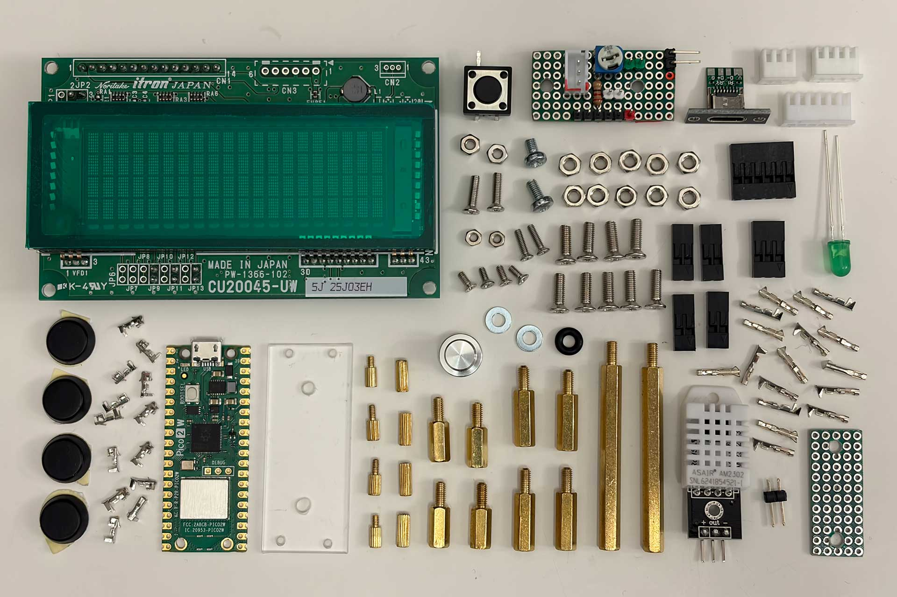
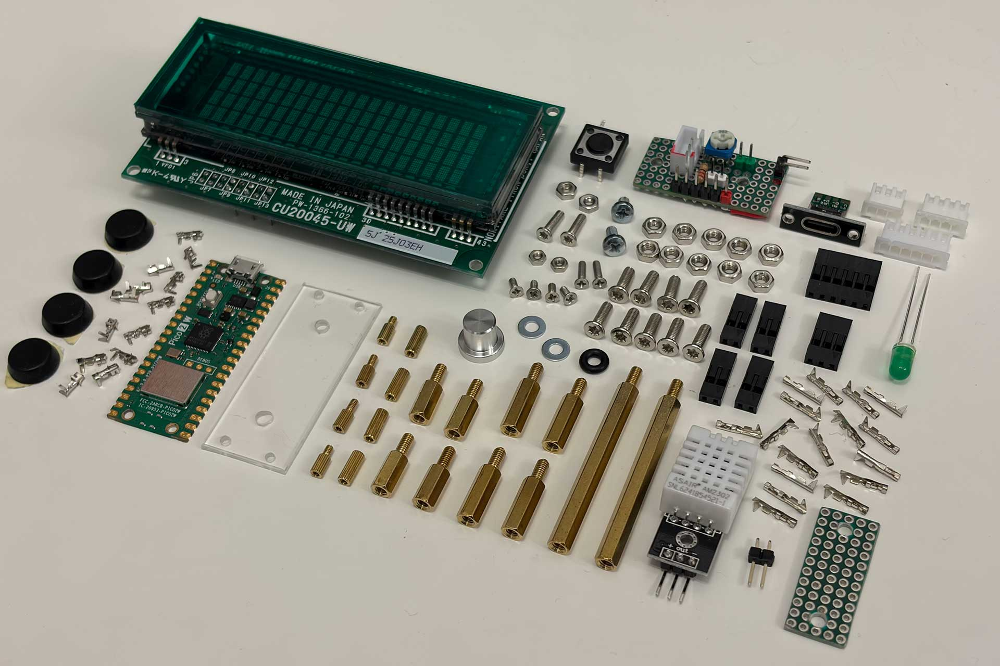
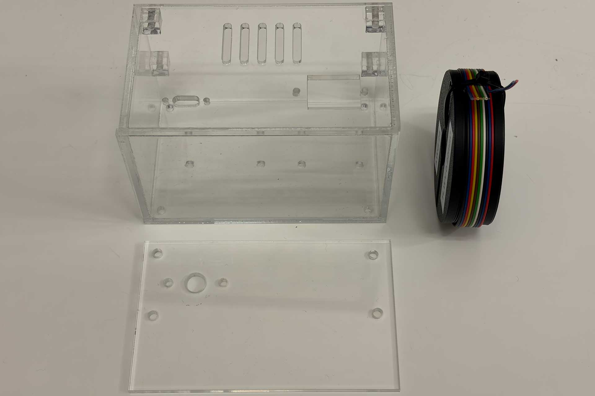
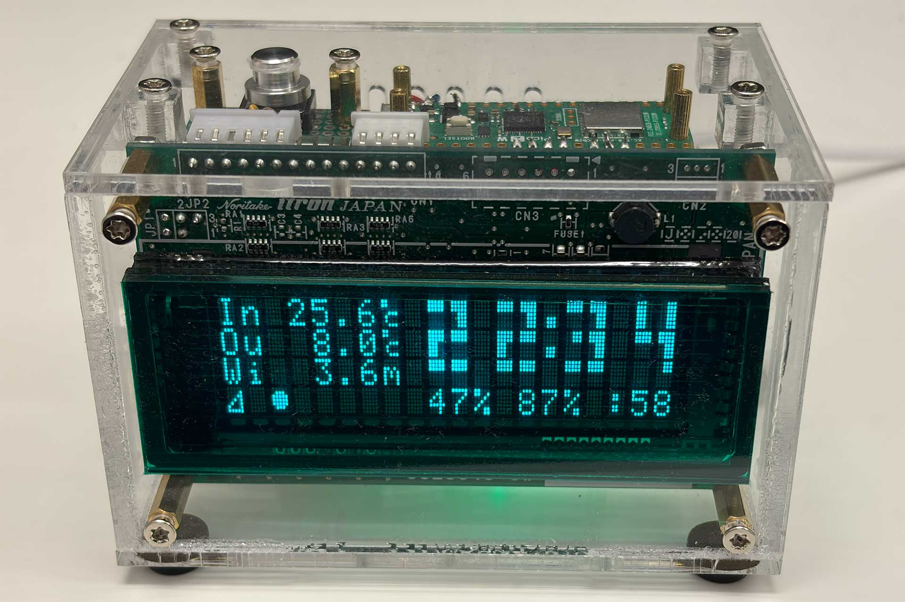
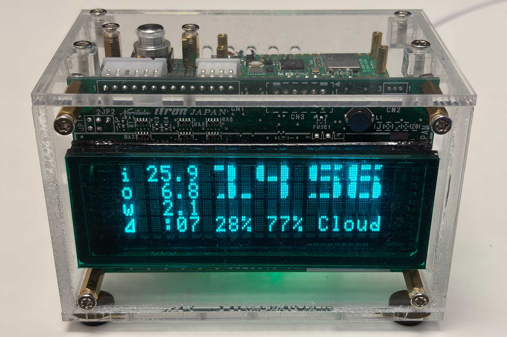
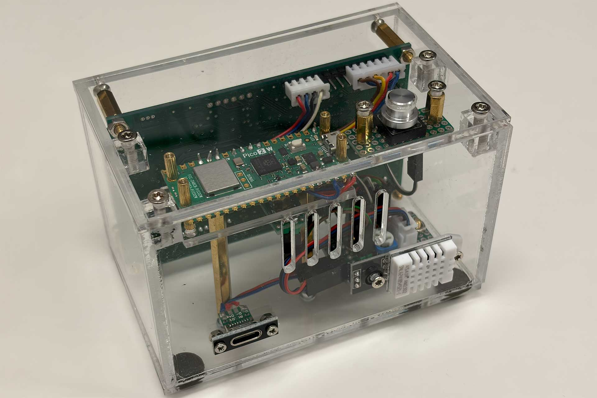
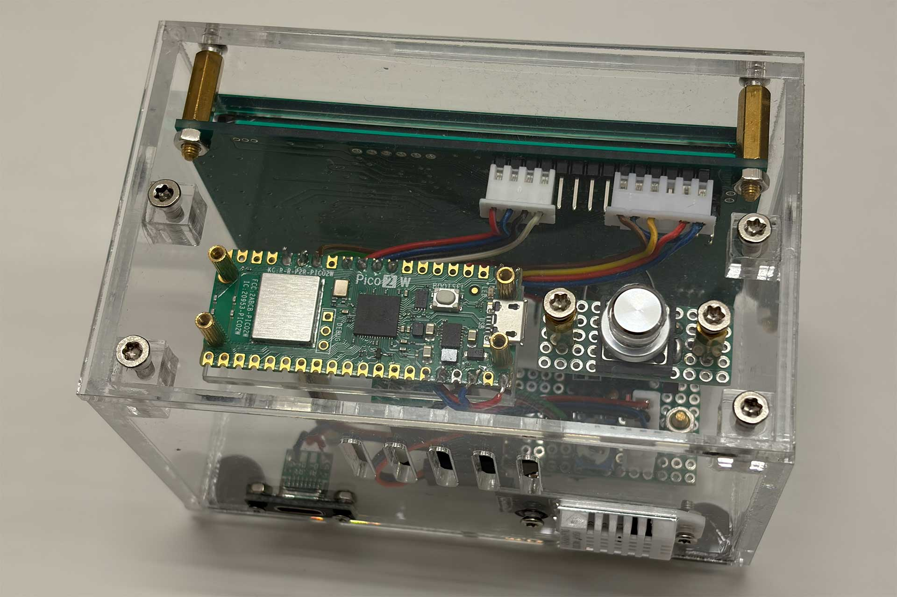
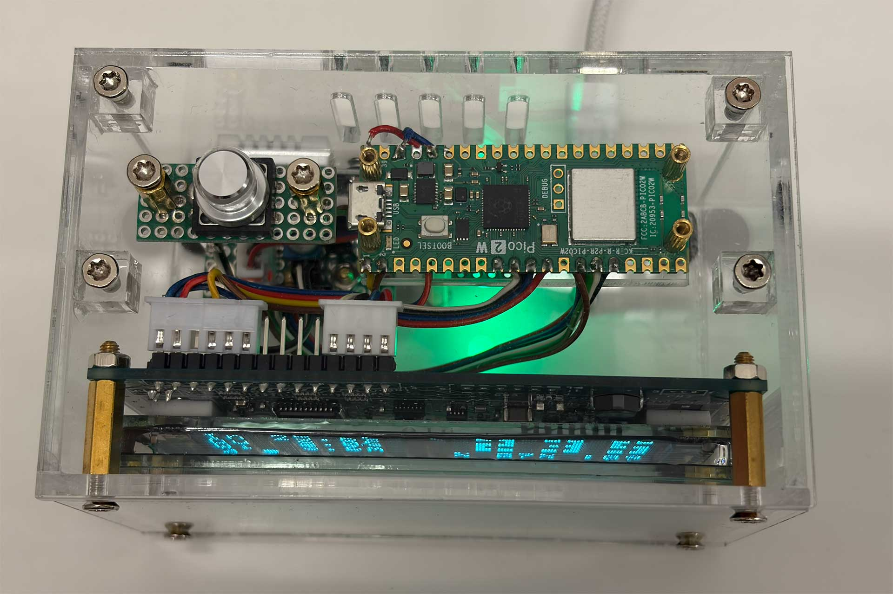
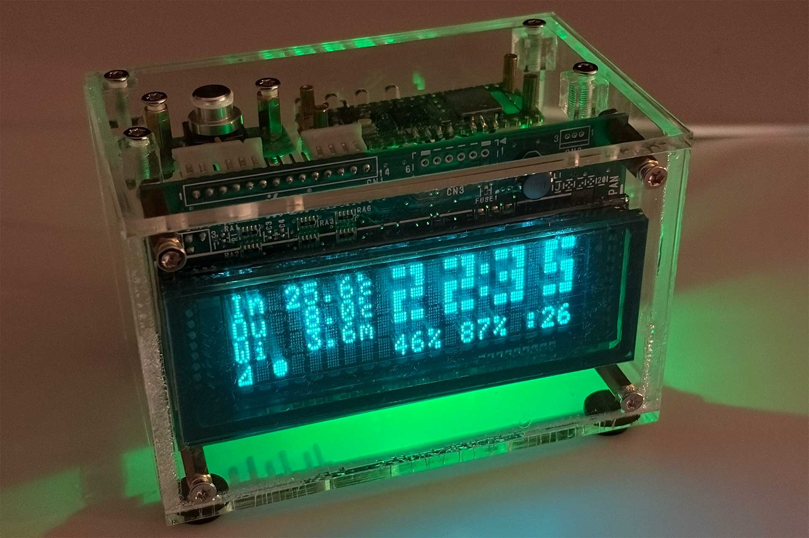
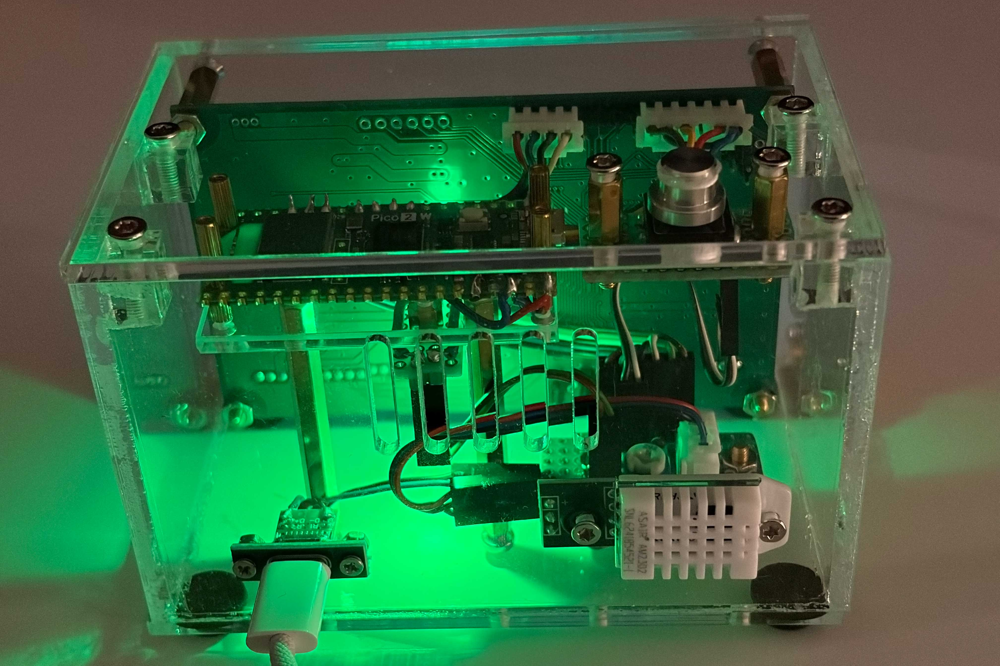

# Weather Clock project

This project displays a weather clock on the CU20045 module.
It shows:

- current time
- current weather information (temperature, humidity, wind speed, and current
  conditions, such as clouds or rain)
- current indoor temperature and humidity (requires a DHT22 sensor).

Only the 20x4 display is supported.

## The build process

To create this project, I connected the CU20045 module to the
Raspberry Pi Pico 2 W the same way as it was done in the other two
projects described in this repository. (I used a 4-bit GPIO connection.)

Additionally, I soldered:
- the DHT22 sensor to GP10 + GND pin + 3.3 V pin
- an LED to GP11 (through a resistor) + GND pin
- a push-button to GP12 + GND pin

The following photos show all the parts I used to build this project:



The main parts were:

- Noritake VFD
- Raspberry Pi Pico 2 W
- DHT22 sensor
- Momentary push button
- Aluminum button cap
- LED
- USB-C port
- Screws (M3, M2.5, M2)
- Standoffs (M3 and M2)
- Rubber feet
- BLS and JST-XH connectors
- Hookup wire
- Prototyping board for the push button
- Prototyping board with a resistor and potentiometer for connecting components



I used a custom-designed acrylic box as the enclosure. I also used 22 AWG wire:



The project might look complex, but what is really needed to make it work is the
connections between the MicroPython board, VFD, LED, and DHT22.

## Python files

The Weather Clock project requires these files:
- `weather_clock.py` - the main file of the project
- `wifi.py` - used for managing the Wi-Fi connection
- `fetchers.py` - used for fetching time and weather data from the Internet
- `settings_handler.py` - the project saves user settings in `settings.txt`
- `large_digits_3_rows.py` - used by the clock on layout 1
- `large_digits_2_rows.py` - used by the clock on layout 2
- `matrix_rain.py` - for showing the Matrix Rain at the start of each hour
- `config.py` - configuration file
- `main_weather_clock.py` - use this file to run the project

You also need the Noritake CU library module files:
- `noritake_cu_gpio.py`
- `noritake_cu_functions.py`
- `lib/lcd_api.py`
- `lib/esp32_gpio_lcd.py`

## How to run it

When using this project, preserve file structures and directories.

Copy the required files from the `CU_Series` directory to the board’s
filesystem,
preserving the `demo/` and `lib/` directories.

Use `demo/config.py` as the source when copying to `demo/config_local.py`.
Edit the copy exactly as explained in the [Digital Clock
project](README.md#digital-clock-project).

There is some configuration to do in `main_weather_clock.py` too. If you have
connected a DHT22, a button, or an LED, then you need to provide their pins:

```python
dht_pin = 10
button_pin = 12
led_pin = 11
```

Numbers refer to GPIO numbers, not physical header pin numbers.

If any of these are not connected, then set their values to `None`.

Once completed, copy `main_weather_clock.py` to the board’s root as
`main.py`
to have it run automatically when the MicroPython board is powered on.

## The DHT22, the LED, and the button

The DHT22 sensor is used for measuring the indoor temperature and humidity.
Without it, that is when its pin is set to `None`, the project will work but the
indoor fields will show `--.-` for temperature and `--` for humidity.

The LED provides decorative lighting inside the acrylic case. Set its pin to
`None` if you are not using it.

The button is used for various functions explained below. When it's not present
(and its pin is set to `None`) some functions are not available.

## Button functions

The functions of the button depend on whether the screen is on (during the day),
dimmed
(during the evening) or off (during the night).

The display is lit during the day, during the evening dim hours, and
while the night-wake function is active.

- Short press:
  - During the day: Changes daytime brightness
  - During dim hours: Nothing
  - During the night: Activates the night-wake function
- Double press (start the second press within 0.5 seconds of releasing the
  first):
  - When the display is lit: Changes LED brightness or turns it on/off
- Long press (hold for at least 1.5 seconds):
  - When the display is lit: Toggles layouts 1 and 2

Night wake turns the display on for 10 seconds. A short press during
a night-wake restarts this timer.

## Settings file

Selected daytime brightness, LED brightness, and layout are saved in the
`settings.txt` file. These settings are loaded at startup.

If you haven't connected a button, you can still choose a fixed daytime
brightness, LED brightness, and layout by editing the `settings.txt` file.

Settings are stored in `settings.txt` in the board’s root directory, alongside
`main.py`.
Use the supplied settings by copying `demo/settings.txt` there.

The settings format is:
```
layout: 1
brightness: 4
led: 4
```

Valid values are:
- 1–2 for layout
- 1–4 for display brightness
- 0–4 for LED brightness (0 means off).

If the file is missing, these defaults are used. Button changes to brightness or
layout create or update the file. A night-wake press alone does not save
settings.

Restart the board after editing it manually.

## Photos of the project

Here are some photos of the completed project:

Layout 1:



Layout 2:



View from the back:



View from the top:



Another view from the top:



How it looks in the dark:



Rearview in the dark:



## Final thoughts

The code includes comments explaining its behavior and configuration.

If you have any questions, feel free to ask me.

